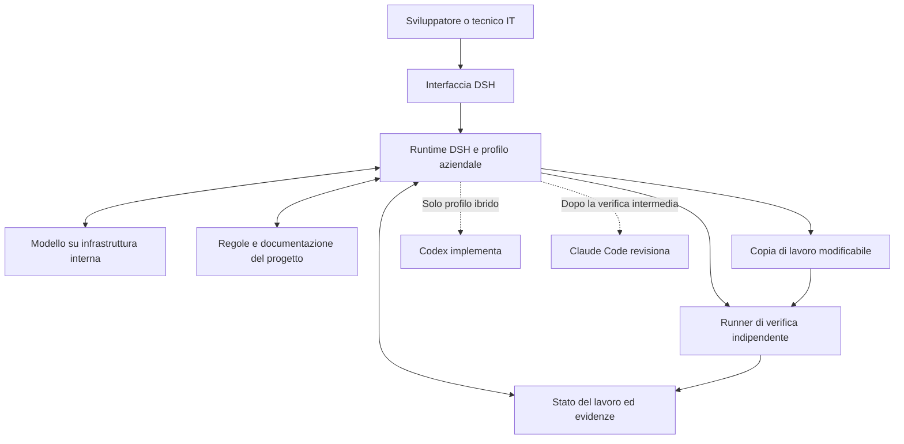

# Progetto del coding agent aziendale basato su DSH

Versione 0.1 — 13 ottobre 2026

Costruiremo una distribuzione aziendale di DeepSeek Harness, configurabile, modificabile e installabile dai colleghi. Potrà lavorare con un modello ospitato sull'infrastruttura aziendale e usare convenzioni, documentazione e strumenti dei nostri progetti. Un'estensione opzionale consentirà di delegare attività a Codex e Claude Code.

Il primo traguardo è un prototipo distribuibile e verificato per un webinar rivolto a sviluppatori e IT. La correzione di un bug in un'applicazione di prova mostrerà il prodotto al lavoro. Le personalizzazioni principali saranno il contesto aziendale, la memoria del lavoro e la verifica dei risultati.

Questa è la proposta di architettura e la roadmap di sviluppo. Componenti, percorsi e criteri contrassegnati come nostri sono da realizzare; le API DSH citate sono punti di integrazione documentati. Il prototipo non è ancora implementato.

## 1 Risultato da consegnare

Il pacchetto finale comprenderà un avviatore, una versione fissata di DSH, il bundle dei nostri plugin, configurazioni di esempio, una guida di installazione e l'applicazione della demo. Un collega dovrà poterlo avviare su una macchina pulita, collegare il modello previsto e ripetere un'attività verificata.

Prevediamo due configurazioni, con directory dati separate:

| Configurazione proposta | Modelli e strumenti | Dimostrazione |
|---|---|---|
| `company-internal` | Modello interno, repository e documenti locali, strumenti aziendali esplicitamente configurati | Lavoro completo con accesso a Internet bloccato e rete interna disponibile |
| `company-hybrid` | Stesse personalizzazioni, più deleghe a Codex e Claude Code | DSH assegna attività, raccoglie risultati e verifica il codice prodotto |

La modalità interna richiede che anche inferenza, dipendenze, risorse dell'interfaccia e strumenti necessari siano disponibili internamente. Un endpoint DeepSeek pubblico resta un servizio esterno. Il profilo interno non caricherà i provider di delega esterna e la prova di rete comprenderà l'intero albero dei processi.

La prima distribuzione sarà destinata a una piattaforma di riferimento, qualificata sulla macchina del webinar. Il pacchetto web locale con avviatore è il risultato minimo; un installer desktop con identità aziendale sarà un'evoluzione successiva.

## 2 Perché partire da DSH

DSH compone il prodotto attraverso plugin, profili e bundle. Anche adattatore del modello, registro degli strumenti, log delle sessioni e loop dell'agente sono sostituibili. Partiremo da questa struttura per mantenere le nostre estensioni in pacchetti separati dal codice upstream. [Architettura DSH](https://github.com/deepseek-ai/deepseek-harness/blob/master/docs/architecture.md)

Valutiamo tre opzioni:

| Opzione | Implicazione per il progetto | Scelta iniziale |
|---|---|---|
| Profilo e plugin esterni a DSH | Riutilizziamo il prodotto e rendiamo esplicite le nostre personalizzazioni | Preferita |
| Fork di DSH | Possiamo modificare qualsiasi componente, assumendo il costo degli aggiornamenti | Solo se incontriamo un limite concreto |
| Prodotto costruito sopra OpenCode o un SDK commerciale | Offre molti degli stessi risultati attraverso un'architettura diversa | Alternativa da confrontare su una modifica precisa |

OpenCode è anch'esso MIT e documenta provider configurabili, estensioni del contesto, compattazione personalizzata e SDK. Apertura e modelli locali non sono esclusive DSH. Il webinar mostrerà il lavoro svolto su DSH e i suoi compromessi; un vantaggio comparativo richiederà misure. [Licenza OpenCode](https://github.com/anomalyco/opencode/blob/dev/LICENSE), [plugin V2](https://opencode.ai/v2/docs/build/plugins/), [SDK V2](https://opencode.ai/v2/docs/build/sdk/)

## 3 Perimetro della prima versione

### Funzionalità incluse

- Avvio ripetibile con versione del runtime e plugin fissate.
- Collegamento a un modello interno qualificato per l'uso degli strumenti.
- Lettura e modifica di una copia di lavoro del repository.
- Regole di progetto e documentazione selezionate per l'attività.
- Stato del lavoro persistente, separato dalla cronologia della chat.
- Esecuzione di verifiche indipendenti e rapporto legato alla versione del codice.
- Stato visibile nell'interfaccia: in corso, da verificare, verificato, fallito o interrotto.
- Profilo ibrido con deleghe sequenziali a Codex e Claude Code.
- Pacchetto installabile, istruzioni di ripristino e registrazione di una prova completa.

### Evoluzioni successive

Accesso multiutente centralizzato, portale amministrativo, ricerca documentale su larga scala, esecuzioni distribuite, distribuzione su più sistemi operativi e integrazione con ticket reali potranno seguire il prototipo. La prima versione consegnerà patch e rapporti revisionabili; pubblicazione, merge e rilascio applicativo resteranno processi separati.

## 4 Architettura proposta



Il runtime gestisce conversazione, modello e strumenti. I nostri plugin forniscono contesto e stato, avviano le verifiche e stabiliscono quando esiste un risultato verificato. Il modello può proporre un'azione o una conclusione; i controlli eseguibili producono le attestazioni del sistema.

Il codice dell'applicazione resta modificabile nella copia di lavoro. Configurazione del runner, suite di accettazione e registro delle attestazioni risiedono fuori dai percorsi modificabili dai lavoratori. Il runner esegue lo snapshot candidato in un ambiente separato.

DSH e i suoi provider costituiscono la base del prodotto; modello di inferenza e GPU appartengono all'infrastruttura. Installare l'harness non installa automaticamente un modello adeguato.

## 5 Come personalizziamo DSH

I nomi seguenti sono nomi di progetto proposti, non pacchetti già pubblicati.

| Componente nostro | Funzione | Punto di integrazione DSH | Effetto visibile |
|---|---|---|---|
| `company-bundle` | Seleziona plugin, profili e impostazioni predefinite | Bundle e patch di configurazione | Stessa configurazione sui computer dei colleghi |
| `company-context` | Inserisce regole e documenti pertinenti | Sezioni e contesto dinamico del system prompt | L'agente applica le convenzioni del progetto |
| `company-task-state` | Conserva obiettivo, ipotesi, evidenze e fase | Storage e contesto dell'agente | Il lavoro mantiene i riferimenti dopo la compattazione |
| `company-verification` | Esegue i controlli e autorizza il risultato verificato | Tool registry, guardia sul risultato e fine turno | Un messaggio di successo non basta a chiudere il lavoro |
| `company-delegation` | Governa il passaggio fra DSH, Codex e Claude Code | Provider subagent ufficiali | Le deleghe producono risultati controllati |

### Contesto aziendale

Iniziamo con tre fonti curate: convenzioni del repository, mappa essenziale dell'applicazione e istruzioni per riprodurre/testare il problema. Ogni documento avrà versione e provenienza. Il plugin selezionerà le parti utili alla fase corrente, mantenendo un budget di contesto configurabile.

Le istruzioni stabili descriveranno stile del codice, criteri di accettazione e strumenti disponibili. I dati variabili comprenderanno file interessati, test falliti e stato dell'indagine. Documenti e log dell'applicazione saranno trattati come materiale da analizzare, senza consentire loro di cambiare le regole del runtime.

DSH espone sezioni ordinate e contributi dinamici attraverso `ctx.systemPrompt`; useremo queste interfacce invece di concatenare tutto in un singolo prompt. [System prompt](https://github.com/deepseek-ai/deepseek-harness/blob/master/packages/core/system-prompt/README.md)

### Memoria del lavoro

Il nostro stato iniziale conterrà:

| Campo proposto | Contenuto |
|---|---|
| `taskId` e `schemaVersion` | Identità del lavoro e versione del formato |
| `objective` e `acceptanceCriteria` | Obiettivo e condizioni concordate per considerarlo concluso |
| `phase` e `attempts` | Fase corrente e tentativi già eseguiti |
| `hypotheses` | Ipotesi aperte, escluse o confermate, con motivazione |
| `evidence` | Riferimenti a file, log e verifiche, con versione e data |
| `pendingChecks` | Controlli ancora da eseguire |
| `candidateDigest` e `verificationRunId` | Collegamento fra codice candidato e verifica |
| `delegations` | Stato degli incarichi esterni, se abilitati |

Il lavoratore potrà proporre aggiornamenti a ipotesi e note. Gli esiti dei test saranno scritti dal runner; l'agente non potrà marcare autonomamente un test come superato. Un'ipotesi resterà collegata alla versione del codice sulla quale è stata verificata, così una modifica successiva potrà renderla da ricontrollare.

Alla riapertura della sessione e prima dei passi pertinenti, il plugin ricostruirà un riepilogo compatto da questo stato. La cronologia potrà essere compattata mantenendo il registro del lavoro disponibile. La prima versione userà il meccanismo di compattazione standard di DSH; sostituirne l'algoritmo sarà un esperimento separato, se emergono limiti misurabili.

Lo storage DSH offre mattoni per persistere dati di dominio. Lo schema sopra, le transizioni e la riconciliazione dopo un'interruzione sono responsabilità nostre. [Storage DSH](https://github.com/deepseek-ai/deepseek-harness/blob/master/docs/subsystems/storage.md)

### Verifica e completamento

Creeremo uno strumento di verifica e uno di consegna, indicativamente `company_verify` e `company_finish`. Il secondo accetterà soltanto un riferimento a una verifica valida dello snapshot corrente.

Il percorso previsto sarà:

1. Congelare uno snapshot dei file che influenzano il comportamento, inclusi configurazione e dipendenze dichiarate.
2. Calcolarne l'impronta e avviare la suite di accettazione indipendente, con dati di prova azzerati.
3. Salvare risultato, ambiente, versione della suite, durata ed evidenze nel registro controllato dal runtime.
4. Confrontare di nuovo l'impronta prima della consegna. Una modifica successiva invalida il rapporto precedente.
5. In caso di fallimento, restituire all'agente i casi falliti e richiedere una correzione entro il budget.

Il candidato potrà aggiungere test di progetto; non potrà rimuovere o indebolire la suite esterna. Il runner userà comandi controllati e isolamento del processo per eseguire il codice candidato, evitando che quest'ultimo scriva le proprie attestazioni.

`ctx.tools.guard` può negare la consegna; `agent/turn-stopping` consente di richiedere ulteriore lavoro quando l'agente tenta di concludere. La guardia protegge il percorso dei tool DSH: i poteri della shell e dei processi esterni vanno configurati separatamente. [Tool runtime](https://github.com/deepseek-ai/deepseek-harness/blob/master/packages/core/tools/README.md), [contratti dell'agente](https://github.com/deepseek-ai/deepseek-harness/blob/master/packages/core/agent/src/runtime-types.ts)

Imposteremo inizialmente un massimo di due cicli di correzione dopo il primo esito negativo. Timeout e numero massimo di richieste saranno configurabili e calibrati nelle prove. All'esaurimento il lavoro terminerà come fallito o bisognoso di intervento, con evidenze disponibili. Questi limiti sono regole del nostro controller, non valori garantiti dal loop standard.

Il messaggio finale dell'LLM resterà un messaggio. Lo stato «verificato» mostrato dal prodotto sarà scritto solo dal controllo di completamento.

### Interfaccia

Riutilizzeremo l'interfaccia DSH. Aggiungeremo una vista compatta con fase, ipotesi, verifiche e artefatti, collegata agli eventi reali. Il nome aziendale e le impostazioni del profilo renderanno riconoscibile la distribuzione; eventuali limiti degli slot UI saranno verificati prima di investire in un'interfaccia nuova. [Estensioni dell'interfaccia](https://github.com/deepseek-ai/deepseek-harness/blob/master/packages/client/ui-slots/README.md)

## 6 Modello e infrastruttura interna

La scelta del modello dipenderà dall'hardware disponibile e dal risultato sui nostri casi. DSH documenta un adattatore multiprovider con endpoint compatibili e server self-hosted. Occorre comunque qualificare il protocollo e il comportamento del modello scelto. [Provider pi-ai](https://github.com/deepseek-ai/deepseek-harness/blob/master/packages/llm/llm-pi-ai/README.md)

Prima di sviluppare le personalizzazioni registreremo:

- sistema operativo, RAM, GPU e memoria video disponibili;
- modello, revisione dei pesi, quantizzazione e runtime di inferenza;
- endpoint, autenticazione e protocolli effettivamente supportati;
- finestra di contesto e limiti di output configurati;
- comportamento con chiamate agli strumenti, streaming, errori e cancellazione;
- tempi di una diagnosi e di una modifica con test sul repository dimostrativo.

Per il primo percorso useremo un solo modello e tool calling nativo, se funziona correttamente. L'instradamento dinamico fra modelli resterà opzionale. La modalità interna avrà una configurazione chiusa degli endpoint: se l'inferenza non è disponibile, mostrerà un errore esplicito senza passare automaticamente a servizi esterni.

La prova senza Internet verrà eseguita dopo aver preparato dipendenze, pesi e risorse. Rete interna e loopback resteranno disponibili. Il controllo comprenderà browser, runtime, shell e inferenza; il risultato sarà documentato con le connessioni osservate e una prova applicativa completa.

Se l'hardware non sostiene il modello previsto, valuteremo un modello più piccolo oppure un server aziendale dedicato. Il percorso interamente interno resta un criterio di accettazione della demo principale.

## 7 Orchestrazione di Codex e Claude Code

I provider ufficiali avviano vere sessioni dei rispettivi prodotti. Sono deleghe autonome e restituiscono al padre il risultato finale o un errore. Configurazione e autenticazione native restano rilevanti; non bisogna presumere isolamento automatico, continuazione della sessione delegata o un flusso completo degli eventi interni. [Provider Codex](https://github.com/deepseek-ai/deepseek-harness/blob/master/packages/subagent/subagent-codex/README.md), [provider Claude Code](https://github.com/deepseek-ai/deepseek-harness/blob/master/packages/subagent/subagent-claude-code/README.md)

La directory di lavoro può essere indicata con `cwd` per incarico; se omessa viene ereditata dal chiamante. Il controller la imposterà esplicitamente sulla copia di lavoro o sullo snapshot di revisione. Selezionare una directory non limita da solo l'accesso agli altri percorsi. [Implementazione del tool di delega](https://github.com/deepseek-ai/deepseek-harness/blob/master/packages/subagent/tool-subagent/src/index.ts)

### Sequenza della mini demo

1. Il nostro controller prepara un incarico completo: obiettivo, criteri, percorsi, versione iniziale e risultato atteso.
2. Codex implementa la modifica nella copia di lavoro dedicata.
3. DSH rilegge i file, calcola il diff ed esegue una verifica intermedia.
4. Claude Code riceve un incarico di revisione sullo snapshot preciso della modifica.
5. DSH raccoglie la revisione. Eventuali correzioni diventano nuovi incarichi autonomi entro il budget.
6. Il runner esegue nuovamente la suite sul candidato finale e produce il rapporto di consegna.

Gli incarichi saranno sequenziali: un solo lavoratore scrive per volta. Per la revisione useremo una copia dello snapshot con scrittura impedita dall'ambiente, mantenendo separata la directory necessaria al funzionamento del revisore. La scelta concreta del contenitore o dei permessi del sistema operativo verrà qualificata con entrambi i runtime.

Il prompt «fai solo review» non costituisce un confine di accesso. La restrizione dei tool del padre DSH non impone automaticamente le stesse restrizioni ai processi figli. Le prove dovranno verificare i permessi effettivi nel profilo ibrido.

L'interfaccia mostrerà incarico, inizio, stato e risultato ricevuto. Diff e test saranno raccolti dal nostro controller. I contatori di consumo dei lavoratori verranno esposti solo se ottenibili da una fonte affidabile: non li ricaveremo dal testo finale.

Se un lavoratore fallisce o scade il tempo, interromperemo l'incarico e marcheremo la copia come da ricontrollare. La cancellazione non implica rollback. Al riavvio un incarico dall'esito ignoto non sarà rieseguito automaticamente prima di ispezionare lo stato del workspace.

Il profilo ibrido utilizzerà repository e log sintetici della demo. Le credenziali verranno predisposte sulla macchina e non incluse nel pacchetto distribuito. La disponibilità di un abbonamento interattivo non sarà assunta come prova che l'accesso richiesto dal provider funzioni: lo testeremo con un incarico minimo per ciascun prodotto.

## 8 Organizzazione del progetto

Struttura proposta per l'implementazione:

```text
dsh-demo/
  packages/
    company-bundle/          composizione DSH e dipendenze dei plugin
    company-context/         documenti e regole per fase
    company-task-state/      schema del lavoro e persistenza
    company-verification/    runner client e controllo del completamento
    company-delegation/      sequenza e risultati dei lavoratori esterni
  profiles/
    internal/               impostazioni del percorso interno
    hybrid/                 impostazioni con deleghe esterne
  company-knowledge/        convenzioni e documentazione curate
  demo/
    orders-app/             applicazione modificabile di prova
    fixtures/               dati iniziali e richieste riproducibili
  verifier/                 suite e runner controllati dal prodotto
  evaluations/              casi, configurazioni e rapporti dei confronti
  distribution/             manifest, avviatore e pacchetto di rilascio
  docs/                     progetto, installazione e conduzione webinar
```

TypeScript è la scelta iniziale per i plugin. Lo schema del lavoro userà lo storage di dominio DSH, con backend locale da fissare nella qualificazione. Sceglieremo per l'applicazione di prova uno stack piccolo, preferibilmente già familiare al team, con dipendenze disponibili offline.

Questa struttura descrive il sorgente. Durante l'esecuzione, suite, attestazioni e impostazioni autorevoli saranno collocate fuori dal workspace modificabile. Una cartella diversa nello stesso repository non basta a renderle protette.

## 9 Fasi di realizzazione

Ogni fase termina con un risultato verificabile. Le fasi 0–4 costituiscono il percorso principale; la delega esterna si aggiunge dopo che l'agente interno funziona.

### Fase 0 Qualificare macchina e modello

Raccogliere i dati della sezione 6, selezionare una piattaforma e fissare la versione DSH da usare. Verificare il modello con lettura di file, una modifica, esecuzione di un test e gestione di un errore. Registrare endpoint e versioni senza includere segreti.

**Consegna:** scheda ambiente e risultato della prova minima. **Criterio di uscita:** il percorso modello → strumenti → esito funziona sull'infrastruttura scelta. La data del webinar e le risorse disponibili serviranno a dimensionare il lavoro successivo.

### Fase 1 Creare la distribuzione iniziale

Preparare il progetto versionato e il pacchetto `company-bundle`; inizializzare un profilo web dedicato, aggiungere il bundle e fissare il lockfile. Usare una directory dati del prodotto distinta dalla configurazione personale degli sviluppatori. Conservare la composizione effettiva del runtime come artefatto della build. Il profilo deve nascere dal template `web`: aggiungere un plugin a un nome nuovo non basta a includere l'interfaccia.

La documentazione supporta sviluppo su Windows nativo o WSL; useremo un solo ambiente per checkout e dipendenze. I requisiti Node e pnpm andranno presi dalla versione fissata del repository. [Guida di sviluppo](https://github.com/deepseek-ai/deepseek-harness/blob/master/docs/development.md)

**Consegna:** avvio della UI con modello interno e versione identificabile. **Criterio di uscita:** un collega ripete l'avvio seguendo soltanto le istruzioni del pacchetto.

### Fase 2 Preparare applicazione e verificatore

Realizzare una piccola applicazione ordini con un difetto riproducibile: il primo invio registra l'ordine ma restituisce un timeout; il retry dello stesso identificativo crea un secondo ordine. Preparare dati di reset, log e una versione corretta di riferimento per qualificare la suite, tenuta fuori dalla vista dell'agente.

La suite esterna controllerà che lo stesso identificativo produca un solo ordine, richieste diverse rimangano distinte, dati non validi vengano rifiutati e il flusso normale continui a funzionare. Il comportamento dopo un riavvio dovrà essere incluso se l'applicazione dichiara persistenza.

**Consegna:** scenario che fallisce sul difetto e passa sulla soluzione di riferimento. **Criterio di uscita:** il risultato è riproducibile senza intervento dell'LLM e senza cambiare la suite.

### Fase 3 Aggiungere contesto e memoria del lavoro

Implementare `company-context` e `company-task-state`. Collegare le ipotesi alle evidenze, ripristinare lo stato alla riapertura e limitare quanto viene reinserito nel contesto. La persistenza deve mantenere separati i lavori ed evitare che una prova vecchia venga presentata come attuale.

Provare una compattazione esplicita durante un'indagine: obiettivo, criteri, ipotesi escluse e verifiche pendenti devono restare consultabili. La prova della compattazione sarà dichiarata come test del componente; non assumeremo che il comportamento standard fallisca sempre.

**Consegna:** stato del lavoro visibile e ripristinabile. **Criterio di uscita:** la continuità dipende dai dati salvati, senza chiedere al presentatore di ricordare all'agente i passaggi mancanti.

### Fase 4 Implementare verifica e consegna

Collegare snapshot, runner e attestazioni. Aggiungere il controllo di consegna, la richiesta di correzione e il limite dei tentativi. Verificare il caso in cui l'agente dichiara di aver finito mentre un test fallisce, e quello in cui il codice cambia dopo un rapporto positivo.

**Consegna:** applicazione corretta più rapporto riferito alla versione esatta. **Criterio di uscita:** test falliti, attestazioni assenti o obsolete non producono lo stato «verificato».

### Fase 5 Aggiungere le deleghe esterne

Abilitare i due provider soltanto nel profilo ibrido. Qualificare autenticazione, permessi, directory di lavoro, cancellazione e gestione dei risultati. Implementare la sequenza Codex → verifica intermedia → Claude Code → verifica finale su una copia dedicata.

**Consegna:** una delega reale riuscita a ciascun prodotto, con risultato controllato dal padre. **Criterio di uscita:** errori e timeout non lasciano il sistema nello stato di successo e il profilo interno continua a funzionare senza questi provider.

### Fase 6 Distribuire e misurare

Produrre un pacchetto candidato e installarlo su ambiente pulito. Eseguire le prove con rete esterna bloccata, il ripristino dei dati e il ritorno alla release precedente. Congelare versioni e registrare i risultati dei confronti.

**Consegna:** pacchetto, manuale di avvio e rapporto delle prove. **Criterio di uscita:** il funzionamento non dipende da credenziali, percorsi o cache personali non documentati.

### Fase 7 Preparare il webinar

Provare l'intero percorso con tempi misurati. Preparare snapshot iniziali distinti per la demo interna e quella ibrida. Salvare una registrazione completa come supporto nel caso di problemi di rete o inferenza, dichiarandola come registrazione quando usata.

**Consegna:** scaletta, dati di reset e registrazione. **Criterio di uscita:** almeno due prove complete consecutive, ciascuna ripartendo dallo stato iniziale, senza modifiche manuali nascoste.

## 10 Verifiche di accettazione

| Caso | Risultato richiesto |
|---|---|
| Avvio su macchina pulita | Profilo, plugin e modello risultano identificabili e il primo task funziona |
| Internet bloccato nella modalità interna | L'attività termina usando soltanto servizi interni previsti |
| Modello non raggiungibile | Errore esplicito; nessun passaggio implicito a un provider esterno |
| Compattazione e riapertura | Obiettivo e stato rimangono disponibili con riferimenti alle evidenze |
| Test di accettazione fallito | Stato da correggere o fallito, mai verificato |
| Modifica dopo il test | Attestazione invalidata; nuova verifica necessaria |
| Tentativo di alterare la suite o il registro | Lavoratore e codice candidato non riescono a modificare le fonti autorevoli |
| Delega interrotta | Stato dell'incarico esplicito e workspace ricontrollato prima di riutilizzarlo |
| Revisione esterna | Il revisore può leggere lo snapshot senza modificare il candidato |
| Aggiornamento della distribuzione | Versioni e migrazioni note; ripristino della release precedente provato |

Non basta che la chat finale sia convincente: ogni caso deve produrre un esito osservabile nel filesystem, nel sistema di prova o nel registro del runner.

## 11 Come misurare le personalizzazioni

Il confronto principale sarà DSH standard contro DSH aziendale, con lo stesso modello, la stessa versione dell'applicazione, identiche risorse e gli stessi criteri esterni. Registreremo anche il costo del contesto e delle chiamate introdotte dalle nostre estensioni.

Per un primo esperimento esplorativo prepareremo sei casi: duplicazione su retry, mapping errato di uno stato, errore di paginazione, regressione funzionale, indagine con compattazione e interruzione con ripresa. Tre serviranno allo sviluppo delle istruzioni, tre resteranno separati per la valutazione. Tre ripetizioni per configurazione permetteranno di osservare variabilità, senza presentare il campione come benchmark generale.

Le misure saranno: successo verificato, falsi completamenti, interventi umani, durata totale, richieste e token disponibili. Per inferenza interna riporteremo macchina e tempo di utilizzo; non attribuiremo automaticamente un costo nullo. La mini demo con Codex e Claude Code resterà separata, perché cambia anche il sistema che esegue il lavoro.

Un confronto con OpenCode userà la stessa personalizzazione, suite e modello, su versioni fissate. Valuterà anche modifiche ai file interni, dipendenze e lavoro per aggiornare il runtime. Se realizziamo soltanto DSH standard contro personalizzato, la conclusione riguarderà quel confronto.

## 12 Distribuzione e manutenzione

Il manifest della release registrerà runtime DSH, versioni dei nostri plugin, piattaforma, configurazioni, schema dello stato e suite del runner. Pesi e runtime di inferenza potranno essere distribuiti o gestiti separatamente, con le rispettive condizioni e risorse.

Il pacchetto iniziale conterrà:

- bundle compilato e dipendenze riproducibili;
- avviatore e modelli di configurazione senza credenziali;
- istruzioni per collegare il modello interno;
- applicazione e dati della demo, separati dalla suite autorevole;
- indicazioni per backup, reset della demo e ripristino della release;
- note di versione e rapporti di compatibilità.

Il bundle includerà JavaScript compilato e una patch YAML dichiarata in `dsh.bundle.patch` nel manifest. La prima consegna dei plugin potrà usare un tarball `.tgz`, verificando anche la disponibilità delle dipendenze necessarie. Lo stesso artefatto collaudato sarà promosso nella distribuzione, senza ricompilarlo sulla macchina della demo. [Pubblicazione dei plugin DSH](https://github.com/deepseek-ai/deepseek-harness/blob/master/docs/user/develop/basic/publish.md)

Fisseremo una release per il webinar. Ogni aggiornamento passerà prima da un ambiente di prova e dalla matrice di accettazione. Backup di sessioni e stato precederanno eventuali migrazioni; il rollback del programma dovrà essere compatibile con il formato dei dati oppure ripristinare il backup.

DSH è pubblicato sotto MIT e la sua documentazione segnala la maturità da developer preview. Il prototipo dimostra fattibilità e qualità sulle prove definite; l'adozione su sistemi aziendali reali richiederà la qualificazione del deployment specifico. [Licenza DSH](https://github.com/deepseek-ai/deepseek-harness/blob/master/LICENSE), [stato del progetto](https://github.com/deepseek-ai/deepseek-harness/blob/master/SAFETY.md)

## 13 Scaletta proposta del webinar

| Durata indicativa | Contenuto | Cosa vede il pubblico |
|---|---|---|
| 4 minuti | Obiettivo del coding agent aziendale e componenti di un harness | Architettura e due configurazioni |
| 5 minuti | Avvio della nostra distribuzione | Versione, modello interno, regole e strumenti del progetto |
| 10 minuti | Lavoro sull'applicazione ordini | Bug riprodotto, stato dell'indagine, patch e verifiche |
| 5 minuti | Personalizzazioni del motore | Memoria dopo compattazione e rifiuto di una consegna non verificata |
| 7 minuti | Estensione con Codex e Claude Code | Incarichi reali, risultati e verifica finale |
| 4 minuti | Misure e alternative | Cosa abbiamo ottenuto, costi di manutenzione e confronto con OpenCode |

La durata proposta è di circa 35 minuti, oltre alle domande. I tempi saranno adattati dopo le prove. Il pubblico dovrà distinguere ciò che fornisce DSH, ciò che abbiamo sviluppato noi e ciò che eseguono i lavoratori esterni.

## 14 Prime attività e decisioni

L'ordine di partenza è: qualificare il modello interno, avviare un profilo aziendale minimo, preparare il caso ordini e il verificatore, quindi aggiungere contesto e memoria. L'orchestrazione viene dopo la riuscita del percorso interno.

| Decisione | Valore iniziale proposto | Quando fissarla |
|---|---|---|
| Piattaforma supportata | Una sola piattaforma, quella della macchina del webinar | Fase 0 |
| Modello e inferenza | Endpoint interno con uso degli strumenti qualificato | Fase 0 |
| Tecnologie dei plugin | TypeScript e interfacce pubbliche DSH | Fase 1 |
| Distribuzione iniziale | UI web locale, avviatore e bundle versionati | Fase 1 |
| Persistenza del lavoro | Schema nostro su storage locale DSH | Fase 3 |
| Recupero da arresti | Rilettura dello stato e nuova verifica prima di proseguire | Fase 3 |
| Orchestrazione esterna | Sequenziale, un solo lavoratore scrivente, profilo separato | Fase 5 |
| Confronto OpenCode | Stessa modifica e stesso modello, se incluso nell'esperimento | Fase 6 |

I dati ancora necessari per fissare tempi e modello sono hardware disponibile, eventuale endpoint aziendale già attivo, data e durata del webinar. La roadmap consente di iniziare dalla qualificazione senza costruire in anticipo componenti che potrebbero non servire.

## 15 Riferimento per il primo avvio di sviluppo

Questa sequenza usa PowerShell e una checkout separata dei sorgenti DSH, alla revisione scelta nella fase 0. I comandi sono ricavati dalla documentazione; il loro collaudo sulla nostra macchina è parte della fase 1. Nella checkout DSH occorre prima installare le dipendenze con il pnpm previsto dalla revisione e completare `pnpm run build`.

Il bundle locale indicato sotto dovrà essere creato e compilato nella struttura proposta. La directory dati dedicata evita di incorporare patch e credenziali dei profili personali.

```powershell
$env:DSH_HOME = Join-Path $env:LOCALAPPDATA 'CompanyCodingAgent\internal'

pnpm dsh --profile company-internal --from-default-profile web --dump-config
pnpm dsh plugin --profile company-internal add "C:/Users/e.morucci/Desktop/Project/dsh-demo/packages/company-bundle"
pnpm dsh --profile company-internal --dump-config
pnpm dsh --profile company-internal
```

`--from-default-profile web` si usa per creare il profilo e va omesso negli avvii successivi. L'endpoint interno sarà configurato e verificato prima della prova senza Internet. [Riferimento CLI](https://github.com/deepseek-ai/deepseek-harness/blob/master/apps/cli/reference/README.md)

Per il percorso ibrido si prepara un'altra directory dati e un nuovo profilo web, si aggiunge lo stesso bundle e infine si installano i provider:

```powershell
pnpm dsh plugin --profile company-hybrid add @deepseek-ai/dsh-subagent-codex @deepseek-ai/dsh-subagent-claude-code
```

L'abilitazione dei provider rende disponibili le deleghe; sequenza, isolamento e verifiche sono implementati dal nostro controller. Autenticazione e permessi nativi vanno qualificati prima dell'incarico dimostrativo.

La ricerca di supporto è disponibile in `docs/research/2026-10-13-harness-research.md` e contiene i riferimenti estesi, le alternative considerate e i limiti dei provider.
